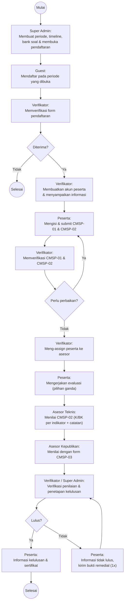

# 01 — Gambaran Sistem

> **Status dokumen:** disusun dari diagram proses bisnis (swimlane) pemilik proyek
> tertanggal 15 November 2026, klarifikasi lanjutan dari pemilik proyek, dan kode yang
> sudah ada. Diagram dibuat sebelum peran Super Admin ditambahkan, sehingga Super Admin
> belum muncul di diagram. Detail yang belum jelas ditandai **[BELUM JELAS]** dan
> dikumpulkan di bagian *Pertanyaan Terbuka*. Dokumen ini terus diperbarui seiring pengembangan.

## Apa itu CMSP?

CMSP adalah sistem informasi untuk mengelola **sertifikasi kompetensi Coach dan Mentor
Sektor Publik** (ASN/pegawai instansi pemerintah). Sistem ini menggantikan proses manual
(formulir kertas, email, spreadsheet terpisah) dengan satu alur digital mulai dari
pendaftaran hingga terbitnya sertifikat.

Nama sertifikasi yang saat ini dipakai di form: *Certified Public Sector Performance
Coach and Mentor*.

### Tujuan

- Mempermudah peserta mendaftar, mengisi asesmen, dan memantau status sertifikasinya.
- Memastikan setiap tahapan berjalan sesuai jadwal (timeline) periode.
- Memberi Verifikator dan Asesor tempat kerja terpusat untuk memeriksa dan menilai.
- Menyimpan jejak keputusan (siapa memverifikasi/menilai, kapan, apa catatannya).

## Istilah

| Istilah | Arti |
| --- | --- |
| **Guest** | Calon peserta yang belum punya akun; mendaftar lewat form publik. |
| **Jenis sertifikasi** (`certification_type`) | Jenis sertifikasi yang diselenggarakan. |
| **Kategori** (`certification_category`) | Sub-kategori dalam satu jenis sertifikasi. |
| **Periode** (`certification_period`) | Satu gelombang sertifikasi untuk satu jenis + kategori. Hanya **satu periode aktif** pada satu waktu. |
| **Timeline** | Jadwal 8 tahapan dalam satu periode. |
| **Person** | Data induk individu (berdasarkan NIP), bisa ikut banyak periode. |
| **Application / Pengajuan** | Pendaftaran satu person pada satu periode. |
| **CMSP-01** | Formulir Data Pemohon / Permohonan Sertifikasi — diisi Peserta. |
| **CMSP-02** | Formulir Self Assessment berisi indikator kompetensi + bukti dukung — diisi Peserta, lalu **dinilai Asesor Teknis** per indikator: **K** (Kompeten) / **BK** (Belum Kompeten) + catatan. |
| **CMSP-03** | Formulir penilaian aspek kepublikan — **hanya diisi Asesor Kepublikan**; peserta tidak menginput apa pun. Indikatornya akan diberikan pemilik proyek. |
| **Bank soal** | Kumpulan soal pilihan ganda yang dibuat Super Admin dan dipasangkan ke periode. |
| **Evaluasi** | Ujian **pilihan ganda** yang dikerjakan Peserta memakai soal dari bank soal periode tersebut. |
| **Remedial** | Kesempatan ulang **satu kali** bagi Peserta yang tidak lulus: peserta mengirim bukti dukung (mis. link Google Drive) atas tugas remedial yang disampaikan penyelenggara secara lisan. |
| **K / BK** | Kompeten / Belum Kompeten — pilihan penilaian Asesor Teknis per indikator. |
| **Override** | Super Admin membuka/menutup tahapan secara manual di luar jadwal. |

## Role

| Role | Label | Tugas dalam proses |
| --- | --- | --- |
| *(tanpa akun)* | Guest | Mendaftar pada periode yang sedang dibuka. |
| `PESERTA` | Peserta | Mengisi & submit CMSP-01 dan CMSP-02 (dengan bukti dukung), memperbaiki jika diminta, mengerjakan evaluasi pilihan ganda, menerima hasil (lulus + sertifikat / tidak lulus + remedial satu kali). |
| `VERIFIKATOR` | Verifikator | Memverifikasi pendaftaran, membuatkan akun peserta, memverifikasi CMSP-01 & 02 (bisa meminta perbaikan), meng-assign peserta ke asesor, memverifikasi penilaian. |
| `TECHNICAL_ASSESSOR` | Asesor Teknis | Melihat isian & bukti CMSP-02 peserta, memberi **K/BK per indikator** + catatan. |
| `PUBLIC_ASSESSOR` | Asesor Kepublikan | Menilai peserta dengan form **CMSP-03** (tanpa input dari peserta). |
| `SUPER_ADMIN` | Super Admin | Pengelola utama: periode & timeline, override tahapan, akun pegawai, **bank soal evaluasi**, koneksi Google Drive, **menetapkan kelulusan**. Juga dapat mengakses **sebagian fitur Verifikator dan Asesor**. |

> **Catatan diagram:** diagram dibuat sebelum peran Super Admin ditetapkan. Langkah
> *"Membuat Periode Sertifikasi & Membuka Akses Pendaftaran"* yang di diagram berada di
> lajur Verifikator, di sistem dilakukan oleh **Super Admin** (sesuai kode saat ini).

Akun pegawai (Verifikator, Asesor) dibuat oleh Super Admin lewat Manajemen Akun.
**Super Admin hanya satu** dan dibuat lewat terminal (`npm run create-super-admin`; script menolak
jika sudah ada Super Admin aktif). Super Admin tidak dapat dibuat, di-reset kata sandinya, atau
diubah statusnya dari Manajemen Akun. Tidak ada endpoint yang dapat mengubah role akun.
Akses edit ke spreadsheet autentikasi & file Service Account tetap harus dibatasi ke pemilik.
Akun Peserta dibuat **otomatis** saat pendaftarannya diterima Verifikator.

## Alur Proses Bisnis



### Pemetaan ke 8 tahapan timeline

| # | Kode tahap | Langkah di diagram | Pelaku | Status fitur |
| --- | --- | --- | --- | --- |
| — | *(persiapan)* | Membuat periode, timeline & membuka akses pendaftaran | Super Admin | ✅ |
| — | *(persiapan)* | Menyusun bank soal & memasangkannya ke periode | Super Admin | ❌ |
| 1 | `REGISTRATION` | Guest mendaftar pada periode yang dibuka | Guest | ✅ |
| 2 | `DOCUMENT_VERIFICATION` | Verifikasi form pendaftaran → diterima/ditolak → buat akun peserta | Verifikator | ✅ |
| 3 | `SELF_ASSESSMENT` | Peserta mengisi & submit CMSP-01 & CMSP-02 | Peserta | 🚧 UI awal |
| 4 | `SELF_ASSESSMENT_VERIFICATION` | Verifikasi CMSP-01 & 02, minta perbaikan, assign ke asesor | Verifikator | ✅ |
| 5 | `EVALUATION` | Peserta mengerjakan evaluasi pilihan ganda | Peserta | ✅ |
| 6 | `ASSESSOR_ASSESSMENT` | Penilaian CMSP-02 (Teknis), lalu CMSP-03 (Kepublikan) | Asesor Teknis, Asesor Kepublikan | ❌ |
| 7 | `ASSESSMENT_VERIFICATION` | Verifikasi penilaian & penetapan kelulusan | Verifikator / Super Admin | ❌ |
| 8 | `ANNOUNCEMENT` | Informasi lulus + sertifikat / tidak lulus + remedial | Sistem → Peserta | ❌ |

Akses setiap tahap ditentukan jadwal (`start_at`–`end_at`) kecuali di-override Super Admin
(`OPEN` = dibuka manual, `CLOSED` = ditutup manual, `NORMAL` = ikut jadwal).
Saat ini aturan jadwal baru ditegakkan untuk tahap Pendaftaran; tahap lain wajib
menerapkannya saat fiturnya dibuat.

### Rincian per langkah

**A. Persiapan periode** ✅
1. Membuat **periode** (jenis + kategori + nama) → status `DRAFT`.
2. Mengatur **timeline** 8 tahapan (berurutan, tidak boleh tumpang tindih).
3. **Mengaktifkan** periode → `ACTIVE` (timeline harus lengkap; tidak boleh ada periode lain
   yang `ACTIVE`/`CLOSED`). Siklus status:

```
DRAFT ──► ACTIVE ──► CLOSED ──► COMPLETED
             ▲          │
             └──────────┘ (dibuka kembali)
```

**B. Pendaftaran Guest** ✅
- Guest membuka `/pendaftaran`, mengisi data diri dan mengunggah 4 dokumen PDF (maks. 4 MB):
  Ijazah, SK Jabatan, Sertifikat Coaching/Mentoring, Bukti Praktik Coaching/Mentoring.
  Setiap dokumen langsung diunggah saat dipilih (satu request per berkas, di bawah batas
  4,5 MB hosting serverless); tombol Kirim mengirim data form + token dokumen.
- Sistem memeriksa: periode aktif ada, tahap Pendaftaran dibuka, NIP/email tidak bentrok,
  NIP belum diterima di periode ini.
- Data tersimpan dengan status pengajuan `pending_verification`.

**C. Verifikasi pendaftaran** ✅
- Verifikator memeriksa data & dokumen (preview via backend), memberi catatan, lalu memutuskan.
- **Ditolak** → status `rejected`, proses berakhir untuk pengajuan ini.
- **Diterima** → status `accepted`, akun Peserta dibuat (`PENDING_ACTIVATION`), dan
  **informasi disampaikan** lewat email berisi tautan aktivasi (berlaku 24 jam).
  Pengajuan lain dengan NIP & periode yang sama → `superseded`.
- Peserta mengaktifkan akun di `/aktivasi-akun` dan membuat kata sandi.

**D. Self assessment (CMSP-01 & CMSP-02)** 🚧
- Peserta mengisi Data Pemohon (CMSP-01) dan Self Assessment (CMSP-02), lalu **submit**.
- Draft (CMSP-01 & 02 sekaligus) tersimpan ke server; submit hanya jika keduanya lengkap.

**E. Verifikasi CMSP-01 & 02 dan penugasan asesor** ✅
- Menu **Verifikasi Self Assessment** (Verifikator & Super Admin): daftar peserta per periode, detail
  CMSP-01 & 02 read-only, catatan **per form** (CMSP-01 dan CMSP-02).
- Keputusan **hanya** dapat diberikan saat tahap `SELF_ASSESSMENT_VERIFICATION` dibuka dan status `SUBMITTED`.
  Perbaikan peserta juga dilakukan dalam jadwal tahap ini.
- Verifikator memeriksa isian peserta.
- **Perlu perbaikan** → dikembalikan ke peserta beserta catatan, peserta memperbaiki lalu submit ulang
  (bisa berulang).
- **Tidak perlu perbaikan** → Verifikator **meng-assign** peserta ke **satu Asesor Teknis**
  dan **satu Asesor Kepublikan** (menu **Penugasan Asesor**, pilih periode dulu).
  - Hanya untuk peserta dengan self assessment `VERIFIED`, dan hanya saat tahap
    `SELF_ASSESSMENT_VERIFICATION` dibuka.
  - Asesor dipilih dulu per periode (**Asesor Periode Ini**);
    saat menugaskan, pilihan hanya berisi asesor periode tersebut. Asesor yang masih memegang peserta
    tidak dapat dikeluarkan.
  - Penugasan bisa satu per satu atau **sekaligus** (centang beberapa peserta / pilih semua).
  - Satu asesor boleh menangani banyak peserta; jumlah peserta per asesor ditampilkan saat memilih.
  - Semua aksi (asesor periode & penugasan) hanya saat tahap `SELF_ASSESSMENT_VERIFICATION` dibuka,
    dan dikunci bila tahap `ASSESSOR_ASSESSMENT` sudah dibuka.
  - **Mitigasi pergantian asesor:** mengganti asesor yang sudah ada wajib disertai alasan; setiap
    penugasan/pergantian dicatat di `assessor_assignment_logs`. Saat fitur penilaian asesor dibuat,
    tambahkan aturan: pergantian ditolak jika asesor lama sudah mulai menilai peserta tersebut.

**F. Evaluasi (pilihan ganda)** ✅ (hanya Super Admin yang mengelola)
- **Bank Soal:** soal pilihan ganda dengan **2–5 opsi** (A–E) dan satu kunci; opsional topik. Soal tidak
  dihapus, hanya diarsipkan. Selalu dapat diubah; ditandai bila sudah digunakan.
- **Paket Soal:** kumpulan soal pilihan dari bank soal; selalu dapat diubah. Halaman ubah paket
  menampilkan periode yang memakainya.
- **Perencanaan Evaluasi (per periode):** paket soal, **jumlah soal N** (diambil acak dari paket),
  **durasi** 30/45/60/90 menit, **passing grade** 0–100, serta centang **acak soal** dan
  **acak opsi jawaban**. **Simpan & Terapkan** menyalin isi soal paket saat itu (snapshot); perubahan
  bank soal/paket sesudahnya ditandai "Ada Perubahan" dan baru berlaku setelah **Terapkan Ulang**.
  Peserta yang sudah mulai tetap memakai versi soalnya, sehingga nilai lama tidak berubah.
- **Peserta** (pengajuan diterima + SA `VERIFIED`) mengerjakan **satu kali** (Super Admin dapat
  **mereset progres** peserta; data lama disimpan sebagai riwayat) saat tahap `EVALUATION`
  dibuka. Bila diaktifkan, urutan soal & opsi diacak per peserta dan disimpan (tetap sama saat dimuat ulang).
- Batas waktu = mulai + durasi, **terpotong** pada akhir tahap Evaluasi. Jawaban tersimpan otomatis;
  saat waktu habis jawaban dikirim otomatis.
- Nilai skala 0–100 (benar ÷ jumlah soal × 100, tidak dijawab = salah), **hanya dilihat Super Admin**
  (di halaman Perencanaan Evaluasi) karena Super Admin yang menetapkan kelulusan.
- Pencegahan kecurangan (deteksi pindah tab, layar penuh, blokir salin) **ditunda** — belum dibutuhkan (keputusan Nov 2026).

**G. Penilaian oleh asesor (berurutan)** ✅
1. **Asesor Teknis — CMSP-02** ✅ (menu Penilaian CMSP-02 di portal `/asesor-teknis`)
   - Hanya menilai peserta yang ditugaskan kepadanya; melihat evidence CMSP-02 (tanpa data pribadi CMSP-01).
   - Untuk **setiap unit kompetensi** (10 unit) memilih **K** (Kompeten) atau **BK** (Belum Kompeten).
   - Mengisi **satu catatan umum** dan memilih rekomendasi **"Asesmen dapat dilanjutkan"** /
     **"Asesmen tidak dapat dilanjutkan"** (catatan wajib bila tidak dapat dilanjutkan).
   - Rekomendasi inilah yang menentukan peserta lanjut ke Asesor Kepublikan; K/BK tidak dihitung otomatis.
   - Dapat **disimpan sebagai draf**; simpan & kirim hanya saat tahap `ASSESSOR_ASSESSMENT` dibuka.
     Setelah dikirim terkunci; **Super Admin** dapat melihat semua penilaian, **ikut mengisi/mengirim** (tercatat atas nama Asesor Teknis yang ditugaskan), dan **membuka kunci**.
   - Asesor Teknis tidak dapat diganti bila penilaian peserta tersebut sudah dimulai.
2. **Asesor Kepublikan — CMSP-03** ✅ (menu Penilaian CMSP-03 di portal `/asesor-kepublikan`)
   - Mengisi form penilaian CMSP-03 secara langsung; tidak ada isian/bukti dari peserta.
   - 3 unit (Orientasi Publik; Pola Pikir Bertumbuh & Kreativitas; Budaya Kerja Transformasional),
     masing-masing berisi elemen kompetensi + indikator penilaian (`shared/utils/cmsp03-units.ts`).
   - Mekanisme sama dengan Asesor Teknis: **K/BK per unit**, satu catatan umum, rekomendasi
     dapat/tidak dapat dilanjutkan, draf/kirim, Super Admin dapat mengisi & membuka kunci.
   - Baru dapat diisi setelah Asesor Teknis **mengirim** penilaian dengan rekomendasi
     "dapat dilanjutkan" (sebelumnya berstatus "Menunggu Asesor Teknis").
   - Asesor Kepublikan tidak dapat diganti bila penilaian CMSP-03 peserta tersebut sudah dimulai.

**H. Verifikasi penilaian & penetapan kelulusan** ❌
- Hasil penilaian kedua asesor diverifikasi, lalu peserta ditetapkan **Lulus** atau **Tidak Lulus**
  (penetapan dapat dilakukan Super Admin).

**I. Pengumuman, sertifikat & remedial** ❌
- **Lulus** → peserta melihat informasi kelulusan & **sertifikat**. Proses selesai.
- **Tidak lulus** → di halaman peserta muncul **tombol ke halaman Remedial**.
  - Tugas remedial disampaikan penyelenggara **secara lisan** (di luar sistem).
  - Peserta mengisi form remedial berisi **bukti dukung** (mis. link Google Drive).
  - Remedial hanya **satu kali**. Hasilnya kembali ke tahap verifikasi/penetapan kelulusan (H).

## Status Data

### Yang sudah ada di sistem

| Data | Nilai | Arti |
| --- | --- | --- |
| Periode | `DRAFT`, `ACTIVE`, `CLOSED`, `COMPLETED` | Lihat siklus di atas |
| Pengajuan | `pending_verification` | Menunggu verifikasi pendaftaran |
| | `accepted` | Pendaftaran diterima, akun peserta disiapkan |
| | `rejected` | Pendaftaran ditolak |
| | `superseded` | Digantikan pengajuan lain (NIP & periode sama) yang diterima |
| Verifikasi pendaftaran | `DITERIMA`, `DITOLAK` | Keputusan verifikator |
| Akun | `PENDING_ACTIVATION`, `ACTIVE`, `SUSPENDED`, `DISABLED` | Hanya `ACTIVE` yang bisa login |

### Usulan untuk tahap berikutnya (belum diimplementasi)

Agar posisi peserta dalam proses mudah dilacak, `application_status` dapat dilanjutkan:

```
accepted
  -> self_assessment_submitted <-> self_assessment_revision   (perlu perbaikan, berulang)
  -> self_assessment_verified  -> assigned_to_assessor
  -> evaluation_completed
  -> technical_assessed        -> public_assessed
  -> passed (lulus, selesai)
     failed -> remedial_submitted -> passed | failed_final    (remedial hanya 1x)
```

Nama dan jumlah status final ditentukan saat merancang tiap fitur.

## Keputusan yang Sudah Dikonfirmasi

| Topik | Keputusan |
| --- | --- |
| Pembuat periode & timeline | Super Admin (diagram lama menempatkannya di Verifikator) |
| Akses Super Admin | Bisa mengakses sebagian fitur Verifikator dan Asesor |
| Bentuk evaluasi | Soal pilihan ganda dari bank soal yang disusun Super Admin dan dipasangkan ke periode |
| Penilaian Asesor Teknis | Berdasarkan isian & bukti CMSP-02; K/BK per indikator + catatan |
| Penilaian Asesor Kepublikan | Form CMSP-03, tanpa input peserta; K/BK per unit (3 unit) + catatan + rekomendasi, seperti Asesor Teknis |
| Urutan & jumlah asesor | Berurutan: 1 Asesor Teknis (CMSP-02) lalu 1 Asesor Kepublikan (CMSP-03) per peserta |
| Remedial | Satu kali; peserta mengirim bukti dukung (link Drive) atas tugas yang disampaikan lisan |
| Identitas pendaftar | NIP = identitas orang, email = akun; satu NIP = satu akun. NIP lama + email baru tetap masuk dengan akun lama. Rincian: [08 K-01](08-keputusan-skenario.md#k-01--identitas-pendaftar-nip-vs-email) |

Rincian skenario lain beserta alasannya dicatat di [08-keputusan-skenario.md](08-keputusan-skenario.md).

## Pertanyaan Terbuka

Tidak perlu dijawab sekarang; dibahas saat fitur terkait dikerjakan.

1. **Fitur Verifikator/Asesor mana saja** yang boleh diakses Super Admin? (mis. memverifikasi
   pendaftaran, menilai sebagai asesor, atau hanya melihat?)
2. **Penetap kelulusan:** Super Admin saja, atau Verifikator juga? Apakah Verifikator memverifikasi
   dulu lalu Super Admin menetapkan?
3. **Dasar kelulusan:** kombinasi apa dari nilai evaluasi, hasil K/BK Asesor Teknis, dan CMSP-03?
   Mis. harus semua indikator K?
4. **Pendaftaran ditolak:** apakah Guest diberi tahu lewat email? Boleh mendaftar ulang di periode yang sama?
5. **Perbaikan CMSP-01/02:** ada batas jumlah perbaikan, atau cukup dibatasi jadwal tahapnya?
6. **Bukti dukung CMSP-02:** berupa unggahan file (PDF/gambar) atau link?
7. **Assign asesor:** satu asesor boleh menangani banyak peserta? Bisa diganti setelah di-assign?
8. **Remedial:** siapa yang menilai bukti remedial, dan dalam tahap/jadwal apa?
9. **Sertifikat:** dibuat otomatis oleh sistem (PDF + nomor sertifikat) atau diunggah manual?
